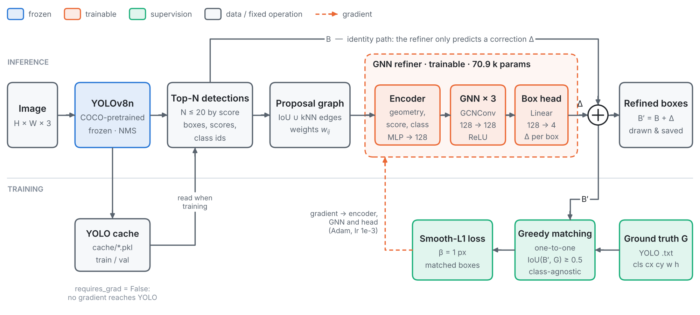
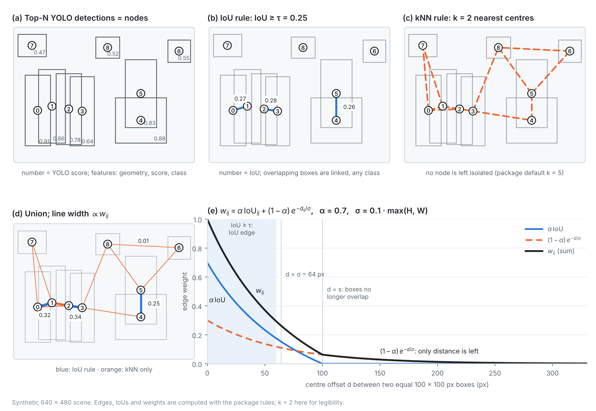
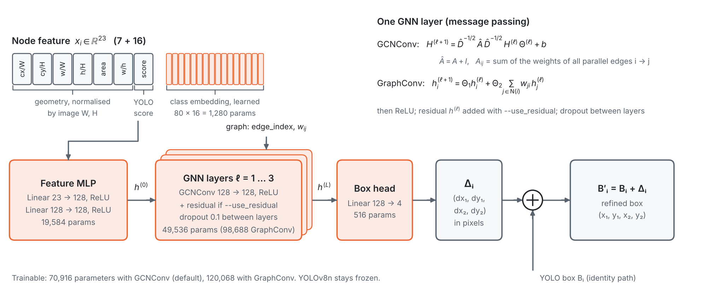
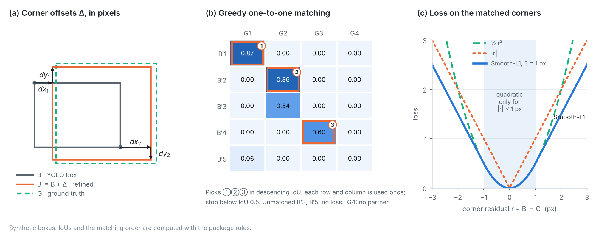
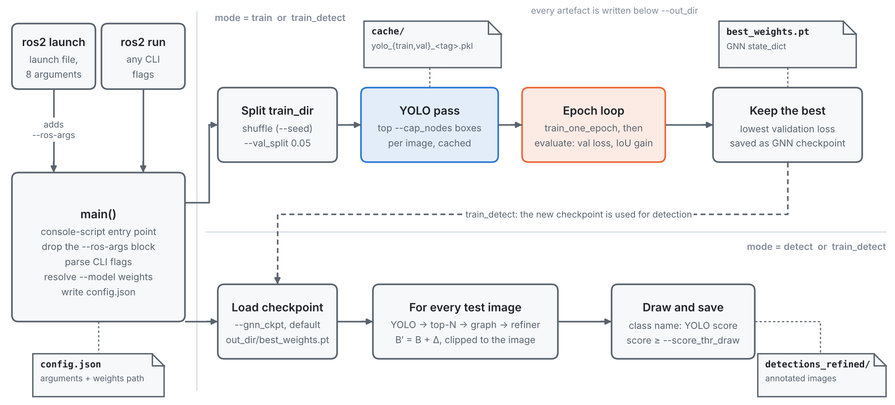

# object_detector_husky

[](https://docs.ros.org/en/jazzy/)
[](https://www.python.org/)
[](https://pytorch-geometric.readthedocs.io/)
[](LICENSE)
[](https://orcid.org/0000-0003-4870-2768)

**Graph-neural-network refinement of frozen YOLOv8 detections, packaged for ROS 2.**
The top-N detections of an image become the nodes of a weighted graph. A lightweight
GNN reads every box together with its overlapping and nearby neighbours and predicts a
pixel correction (dx₁, dy₁, dx₂, dy₂) for it. YOLOv8n stays frozen; only the refiner,
70,916 parameters in the default configuration, is trained.

Svensk version: [README.sv.md](README.sv.md)

<p align="center">
  <picture>
    <source media="(prefers-color-scheme: dark)" srcset="docs/figures/fig1_overview_dark.png">
    
  </picture>
</p>

**Figure 1. System overview.** *Inference (top):* YOLOv8n detects, the top-N detections
form a proposal graph, and the GNN refiner adds a correction Δ to every box,
B′ = B + Δ. *Training (bottom):* YOLO outputs are computed once and cached, refined boxes
are matched one-to-one to the ground truth, and the Smooth-L1 loss updates only the
refiner.

## Contents

- [How it works](#how-it-works)
- [Method](#method)
  - [Proposals](#proposals)
  - [Proposal graph](#proposal-graph)
  - [Node features and GNN refiner](#node-features-and-gnn-refiner)
  - [Training objective and validation metrics](#training-objective-and-validation-metrics)
- [Installation](#installation)
- [Data layout](#data-layout)
- [Usage](#usage)
- [Command-line arguments](#command-line-arguments)
- [Outputs](#outputs)
- [Repository structure](#repository-structure)
- [Implementation notes](#implementation-notes)
- [Regenerating the figures](#regenerating-the-figures)
- [Citation](#citation)
- [Author](#author)
- [License](#license)

## How it works

1. **Frozen detector.** A COCO-pretrained YOLOv8n, bundled as `weights/weights.pt`, runs
   with every parameter frozen (`requires_grad = False`).
2. **Proposals.** For each image, YOLO's post-NMS detections are sorted by score and the
   first `--cap_nodes` (20) are kept: boxes, scores and class ids.
3. **Proposal graph.** Detections that overlap (IoU ≥ 0.25) are linked, and every
   detection is linked to its 5 nearest neighbours. Each edge carries a weight that mixes
   overlap and centre distance.
4. **Refiner.** A feature MLP embeds the normalised geometry, the score and a learned
   class embedding; three GCN layers pass information along the weighted edges; a linear
   head outputs four pixel offsets per box.
5. **Training.** Refined boxes are matched one-to-one to the ground truth (YOLO `.txt`
   labels) at IoU ≥ 0.5, and a Smooth-L1 loss on the matched corners trains the refiner.
   The checkpoint with the lowest validation loss is kept; validation also reports the mean
   change in IoU that the refiner brings to YOLO's boxes.
6. **Detection.** The refined detector runs over a folder of images and writes annotated
   copies.

## Method

### Proposals

For an image of H × W pixels, YOLOv8n returns post-NMS detections. They are sorted by
confidence, optionally filtered by `--conf_thr_keep`, and capped at N ≤ `--cap_nodes`:

```math
b_i=(x_{1},\,y_{1},\,x_{2},\,y_{2})_i\ \text{in pixels},\qquad s_i\in[0,1],\qquad c_i\in\{0,\dots,79\}\ \text{(COCO)},\qquad i=1,\dots,N .
```

### Proposal graph

<p align="center">
  <picture>
    <source media="(prefers-color-scheme: dark)" srcset="docs/figures/fig2_graph_construction_dark.png">
    
  </picture>
</p>

**Figure 2. Building the proposal graph.** (a) Detections are the nodes. (b) The IoU rule
links overlapping boxes of any class, here pedestrians in a crowd and a rider on a bicycle.
(c) The kNN rule links every node to its nearest centres, so no node is isolated
(k = 2 for legibility; the default is 5). (d) The union, with line width proportional to
the edge weight. (e) The edge weight for two equal boxes sliding apart: the IoU term
vanishes once the boxes stop overlapping and only the distance term remains. The scene is
synthetic; every edge, IoU and weight is computed with the package's own rules.

For every pair of detections with centre distance d<sub>ij</sub>:

```math
w_{ij}=\alpha\,\mathrm{IoU}(b_i,b_j)+(1-\alpha)\,\exp\!\left(-\frac{d_{ij}}{\sigma}\right),
\qquad \sigma=\max\bigl(10,\;0.1\,\max(H,W)\bigr),\qquad \alpha=0.7 .
```

Two rules create edges, each inserted in both directions:

| Rule | Condition | Purpose |
|---|---|---|
| IoU | IoU(b<sub>i</sub>, b<sub>j</sub>) ≥ τ = 0.25 (`--iou_thr_graph`) | links overlapping objects of any class: crowds, occlusions, rider and vehicle |
| kNN | j is among the k = 5 nearest centres of i (`--knn`) | gives every node neighbours, also when nothing overlaps it |

### Node features and GNN refiner

<p align="center">
  <picture>
    <source media="(prefers-color-scheme: dark)" srcset="docs/figures/fig3_refiner_architecture_dark.png">
    
  </picture>
</p>

**Figure 3. The GNN refiner.** Each node starts from seven normalised geometric and score
features and a learned 16-dimensional class embedding. A two-layer MLP lifts them to 128
channels, three message-passing layers mix information along the weighted edges, and a
linear head regresses four corner offsets that are added to the YOLO box.

Node feature, with box centre (c<sub>x</sub>, c<sub>y</sub>), width w, height h and class
embedding e<sub>c</sub> ∈ ℝ¹⁶:

```math
x_i=\Bigl[\tfrac{c_x}{W},\ \tfrac{c_y}{H},\ \tfrac{w}{W},\ \tfrac{h}{H},\ \tfrac{w}{W}\cdot\tfrac{h}{H},\ \tfrac{w}{h},\ s_i,\ e_{c_i}\Bigr]\in\mathbb{R}^{23}
```

Refiner, with ρ = 1 when `--use_residual` is set and 0 otherwise, and dropout (p = 0.1)
after every layer but the last:

```math
h_i^{(0)}=\mathrm{MLP}(x_i),\qquad
H^{(\ell+1)}=\mathrm{ReLU}\!\left(\hat D^{-1/2}\hat A\,\hat D^{-1/2}H^{(\ell)}\Theta^{(\ell)}+b^{(\ell)}\right)+\rho\,H^{(\ell)},\qquad
\Delta_i=W_o\,h_i^{(L)}+b_o,\qquad b_i'=b_i+\Delta_i
```

where  = A + I and A<sub>ij</sub> sums the weights of the edges from j to i.
`--conv_type graph` replaces the GCN layer by GraphConv,
h′<sub>i</sub> = Θ₁h<sub>i</sub> + Θ₂ Σ<sub>j</sub> w<sub>ji</sub> h<sub>j</sub>.

| Block | Shape | Parameters, GCNConv (default) | Parameters, GraphConv |
|---|---|---:|---:|
| Class embedding | 80 × 16 | 1,280 | 1,280 |
| Feature MLP | 23 → 128 → 128 | 19,584 | 19,584 |
| GNN layers | 3 × (128 → 128) | 49,536 | 98,688 |
| Box head | 128 → 4 | 516 | 516 |
| **Trainable total** | | **70,916** | **120,068** |

### Training objective and validation metrics

<p align="center">
  <picture>
    <source media="(prefers-color-scheme: dark)" srcset="docs/figures/fig4_training_objective_dark.png">
    
  </picture>
</p>

**Figure 4. What the refiner is trained on.** (a) Δ moves the top-left and bottom-right
corners of the YOLO box independently, in pixels. (b) Greedy matching takes the largest
remaining IoU, pairs that row and column, and stops below 0.5; a duplicate (B′3), a false
positive (B′5) and a missed object (G4) stay unmatched. (c) Smooth-L1 with β = 1 px is
quadratic only for residuals below one pixel and linear beyond.

**Matching.** Refined boxes B′ and ground-truth boxes G are paired greedily and one-to-one
at IoU(B′, G) ≥ 0.5, without looking at classes. Unmatched refined boxes add no loss.

**Loss.** Over the M matched pairs (i, j), averaged over the 4M corner coordinates:

```math
\mathcal{L}=\frac{1}{4M}\sum_{(i,j)\in\mathcal{M}}\ \sum_{k=1}^{4}\ \ell_\beta\!\left(b'_{ik}-g_{jk}\right),
\qquad
\ell_\beta(r)=\begin{cases}\tfrac{1}{2}\,r^2/\beta, & |r|<\beta\\[2pt] |r|-\tfrac{1}{2}\beta, & \text{otherwise}\end{cases},
\qquad \beta=1\ \text{px}
```

With `--score_weighting`, the loss of an image is multiplied by the mean YOLO score of its
matched boxes. Training takes one Adam step per image (learning rate 10⁻³, weight decay
10⁻⁴) and shuffles the images every epoch.

**Validation.** A random `--val_split` share (5 %) of `--train_dir` is held out and
reports, after every epoch,

- `val_loss`, the same loss on the held-out images;
- `mean_IoU_gain`, the mean over matched pairs of IoU(b′<sub>i</sub>, g<sub>j</sub>) − IoU(b<sub>i</sub>, g<sub>j</sub>):
  how far the refiner moves YOLO's boxes towards their ground truth.

The refiner with the lowest `val_loss` is saved as the checkpoint.

## Installation

| Requirement | Notes |
|---|---|
| ROS 2 | developed with Jazzy on Ubuntu 24.04 (Python 3.12) |
| Python | ≥ 3.9 |
| PyTorch | a CUDA build for training on a GPU; CPU works with `--device cpu` |
| PyTorch Geometric, Ultralytics | installed with pip |
| OpenCV, NumPy | from ROS 2 / apt, or pulled in by Ultralytics |

Ubuntu 24.04 marks its system Python as externally managed, so the Python packages go into
a virtual environment that can still see the ROS 2 packages:

```bash
source /opt/ros/jazzy/setup.bash

python3 -m venv --system-site-packages ~/venvs/odh
source ~/venvs/odh/bin/activate
pip install torch torchvision            # choose the CUDA build that matches your driver
pip install torch_geometric ultralytics
```

Build in a colcon workspace. Running colcon through the environment's Python makes the
installed executable use that Python, and `--symlink-install` makes source edits take
effect without a rebuild:

```bash
mkdir -p ~/ros2_ws/src && cd ~/ros2_ws/src
git clone https://github.com/VKHS/object_detector_husky.git
cd ~/ros2_ws
python3 -m colcon build --symlink-install --packages-select object_detector_husky
source install/setup.bash
```

The bundled YOLOv8n weights are installed to
`share/object_detector_husky/weights/weights.pt` and used by default.

## Data layout

Labels follow the YOLO format: one `.txt` per image with the same file stem and one line
per object, `class cx cy w h`, normalised to [0, 1]. Images and labels can share a folder
or live apart:

```text
datasets/coco/
├── images/train2017/000000000009.jpg
└── labels/train2017/000000000009.txt      # one line per object: class cx cy w h
```

```bash
--train_dir datasets/coco/images/train2017 --train_annot datasets/coco/labels/train2017
```

`--test_dir` is a plain folder of `.jpg`, `.jpeg` or `.png` images; it needs no labels.

## Usage

<p align="center">
  <picture>
    <source media="(prefers-color-scheme: dark)" srcset="docs/figures/fig5_ros2_workflow_dark.png">
    
  </picture>
</p>

**Figure 5. Entry points, run modes and artefacts.** `ros2 launch` and `ros2 run` start the
same executable. `train` splits the data, caches YOLO's outputs and keeps the best
checkpoint; `detect` loads a checkpoint and writes annotated images; `train_detect` does
both in one run.

**ROS 2 launch** (eight launch arguments; `model` defaults to the bundled YOLOv8n):

```bash
ros2 launch object_detector_husky object_detector_husky.launch.py \
  mode:=train_detect \
  train_dir:=/data/coco/images/train2017 \
  train_annot:=/data/coco/labels/train2017 \
  test_dir:=/data/test_images \
  out_dir:=/data/runs/odh \
  epochs:=5 \
  device:=cuda
```

**ros2 run** (every flag):

```bash
# train only, GraphConv layers with residual connections
ros2 run object_detector_husky object_detector_husky --mode train \
  --train_dir /data/coco/images/train2017 --train_annot /data/coco/labels/train2017 \
  --out_dir /data/runs/odh_graph --conv_type graph --use_residual --epochs 10

# detect with an existing checkpoint, on the CPU
ros2 run object_detector_husky object_detector_husky --mode detect \
  --gnn_ckpt /data/runs/odh/best_weights.pt --test_dir /data/test_images \
  --out_dir /data/runs/odh_detect --device cpu

# list every argument with its default
ros2 run object_detector_husky object_detector_husky --help
```

Each epoch prints one line:

```text
[EPOCH 1/5] train_loss=…  val_loss=…  mean_IoU_gain=…  time=…s
```

## Command-line arguments

| Argument | Default | Meaning |
|---|---|---|
| `--mode` | `train_detect` | `train`, `detect` or `train_detect` |
| `--model` | `weights.pt` | YOLO weights; a bare name is also looked up in the package's `weights/` folder |
| `--train_dir` | cluster path | training images |
| `--train_annot` | cluster path | YOLO `.txt` labels of the training images |
| `--val_split` | `0.05` | share of `--train_dir` held out for validation |
| `--test_dir` | cluster path | images for refined detection |
| `--out_dir` | cluster path | output folder |
| `--gnn_ckpt` | `<out_dir>/best_weights.pt` | checkpoint written by training and read by detection |
| `--epochs` | `5` | training epochs |
| `--lr` | `1e-3` | Adam learning rate |
| `--weight_decay` | `1e-4` | Adam weight decay |
| `--device` | `cuda` | `cuda`, `cuda:N` or `cpu` |
| `--seed` | `2024` | seed of the split, the initialisation and the image order |
| `--score_weighting` | off | scale each image's loss by the mean score of its matched boxes |
| `--cap_nodes` | `20` | detections (graph nodes) kept per image |
| `--conf_thr_keep` | `0.0` | if > 0, drop detections scored below it before the cap |
| `--iou_thr_graph` | `0.25` | IoU threshold τ of the IoU edge rule |
| `--knn` | `5` | nearest neighbours per node |
| `--alpha_iou` | `0.7` | weight α of IoU against centre distance in w<sub>ij</sub> |
| `--conv_type` | `gcn` | `gcn` (GCNConv) or `graph` (GraphConv) |
| `--layers` | `3` | GNN layers (at least 2) |
| `--in_channels`, `--hidden_channels`, `--out_channels` | `128` | widths of the MLP output and the GNN layers |
| `--emb_dim` | `16` | class-embedding size |
| `--dropout` | `0.10` | dropout after every GNN layer but the last |
| `--use_residual` | off | residual connections between GNN layers |
| `--score_thr_draw` | `0.5` | draw boxes whose YOLO score is at least this |
| `--use_cache` / `--no-use_cache` | on | keep YOLO's train/val outputs on disk and reuse them |

The launch file exposes `mode`, `model`, `train_dir`, `train_annot`, `test_dir`, `out_dir`,
`epochs` and `device`; its `model` default is the installed YOLOv8n. The cluster paths used
as defaults belong to the author's computing environment, so pass your own paths.

## Outputs

```text
<out_dir>/
├── config.json                                # every argument + the weights file actually used
├── cache/
│   ├── yolo_train_<model>_cap<N>_conf<c>.pkl  # YOLO detections of the training split
│   └── yolo_val_<model>_cap<N>_conf<c>.pkl    # ... and of the validation split
├── best_weights.pt                            # GNN state_dict with the lowest val_loss
└── detections_refined/                        # test images with refined boxes and labels
```

The cache file names carry the weights, `--cap_nodes` and `--conf_thr_keep`, so changing
any of them computes a new cache instead of reusing a stale one.

## Repository structure

```text
object_detector_husky/
├── object_detector_husky/
│   ├── __init__.py
│   └── object_detector_husky.py      # YOLO → graph → GNN refiner: training, validation, detection
├── launch/
│   └── object_detector_husky.launch.py
├── weights/
│   └── weights.pt                     # COCO-pretrained YOLOv8n (Ultralytics, AGPL-3.0)
├── docs/
│   ├── make_figures.py                # regenerates every figure of this README
│   └── figures/                       # *_light.png and *_dark.png
├── resource/object_detector_husky     # ament resource marker
├── test/                              # ament_copyright, ament_flake8, ament_pep257
├── package.xml
├── setup.py
├── setup.cfg
├── CITATION.cff
├── LICENSE
├── NOTICE
├── README.md
└── README.sv.md
```

| Function or class | Role |
|---|---|
| `run_yolo_and_cache` | YOLO over a list of images, top-N per image, optional disk cache |
| `build_weighted_graph` | IoU and kNN edges with weights w<sub>ij</sub> |
| `FeatureMLP`, `GNNRefiner` | node encoder, GNN layers and box head |
| `greedy_match` | one-to-one matching at IoU ≥ 0.5 |
| `train_one_epoch`, `evaluate` | Smooth-L1 training; validation loss and mean IoU gain |
| `detect_and_save` | refined detection and drawing |

## Implementation notes

- **Post-NMS proposals.** The refiner sees YOLO's detections after its own confidence
  filtering and NMS, so suppressed duplicates never enter the graph.
- **Parallel edges.** `build_weighted_graph` appends each IoU pair twice per direction and
  each kNN choice once per direction. GCNConv and GraphConv sum parallel edges, so the
  adjacency weight of a pair is m<sub>ij</sub>·w<sub>ij</sub> with
  m<sub>ij</sub> = 2·[IoU ≥ τ] + [j ∈ kNN(i)] + [i ∈ kNN(j)].
- **Self-loops.** GCNConv adds a self-loop of weight 1 to every node before the symmetric
  normalisation.
- **Pixel units.** Δ and the loss are in absolute pixels of the original image.
- **Matching.** Training and validation match the current refined boxes B′; the IoU gain is
  averaged over those pairs.
- **Residual default.** `GNNRefiner(use_residual=True)` is the Python default, while the
  command line enables residuals only with `--use_residual`.
- **One image per step.** Graphs are built on the CPU for every image and step;
  optimisation is not batched.
- **Checkpoint content.** `best_weights.pt` holds the refiner only; YOLO is loaded from
  `--model`, so detection needs the same YOLO weights as training.

## Regenerating the figures

All figures come from one script that needs only NumPy and Matplotlib and writes a light
and a dark version of each:

```bash
python3 docs/make_figures.py            # writes docs/figures/*_light.png and *_dark.png
```

Every edge, weight, IoU, matching step and parameter count shown is computed by the
script with the same rules as the package; the scenes themselves are synthetic.

## Citation

GitHub's **Cite this repository** button reads [`CITATION.cff`](CITATION.cff). In BibTeX:

```bibtex
@software{KhaliliSadaghiani_object_detector_husky,
  author  = {Khalili Sadaghiani, Abdolvahab},
  title   = {{object\_detector\_husky}: graph neural network refinement of frozen {YOLOv8} detections for {ROS} 2},
  year    = {2025},
  url     = {https://github.com/VKHS/object_detector_husky},
  license = {Apache-2.0}
}
```

## Author

**Abdolvahab Khalili Sadaghiani**<br>
Division of Electronics and Computer Engineering, Department of Electrical Engineering,
Linköping University, Linköping, Sweden<br>
Email: [abdolvahab.khalili.sadaghiani@liu.se](mailto:abdolvahab.khalili.sadaghiani@liu.se)<br>
ORCID: [](https://orcid.org/0000-0003-4870-2768)
[https://orcid.org/0000-0003-4870-2768](https://orcid.org/0000-0003-4870-2768)

## License

The code is released under the [Apache License 2.0](LICENSE); see also [`NOTICE`](NOTICE).

`weights/weights.pt` is the COCO-pretrained YOLOv8n checkpoint published by Ultralytics
under the [AGPL-3.0](https://ultralytics.com/license); the Apache license does not cover
it. The `ultralytics` package, a runtime dependency, is AGPL-3.0 as well. Their terms apply to
them; check those terms, or Ultralytics' commercial licensing, before distributing a system
built on them.
