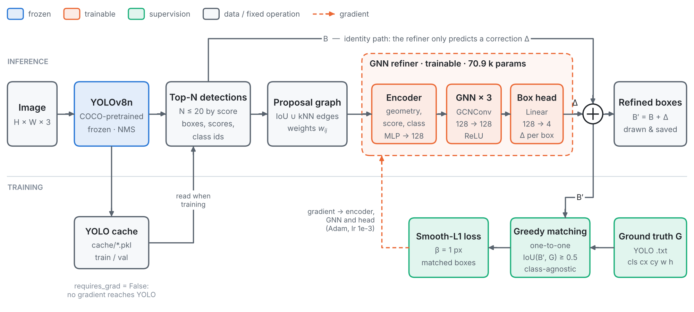
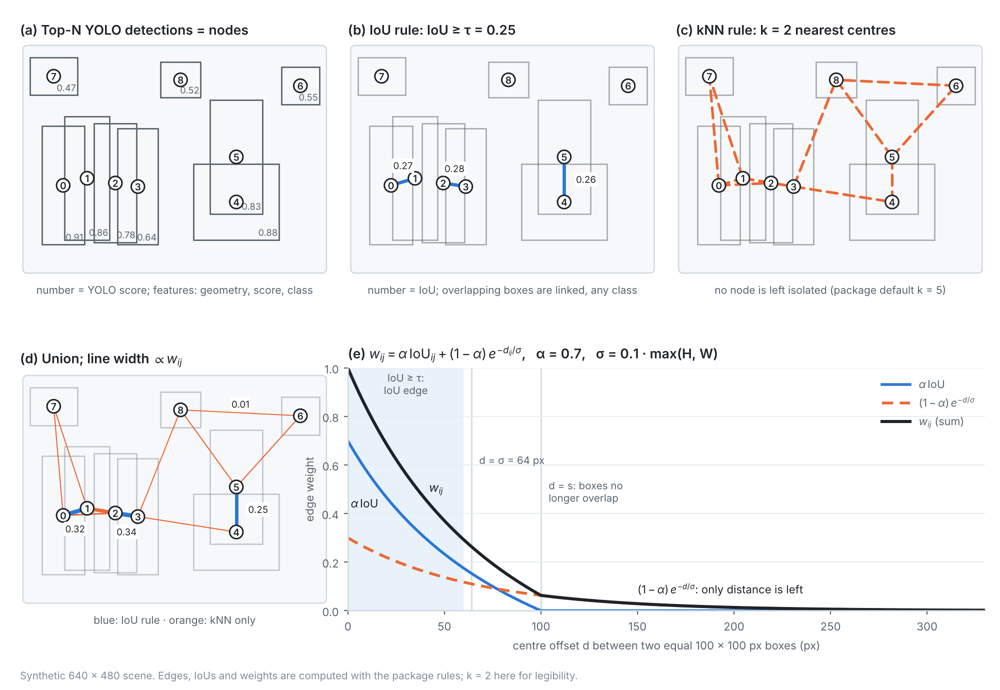
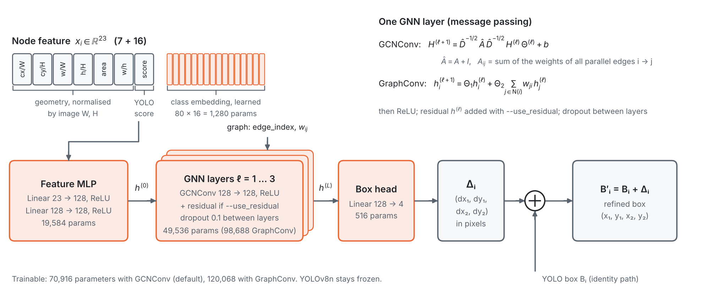
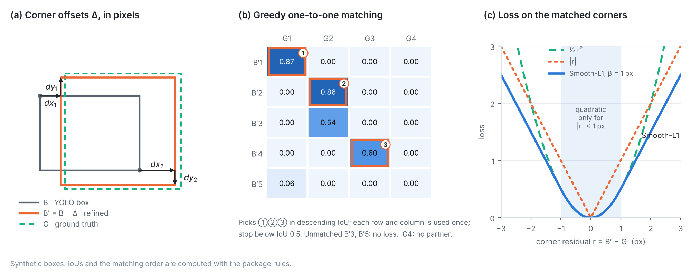
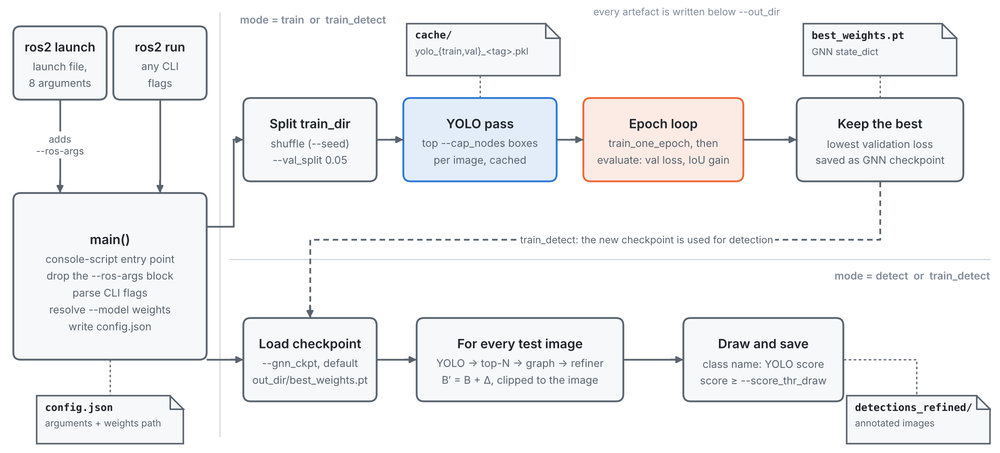

# object_detector_husky

[](https://docs.ros.org/en/jazzy/)
[](https://www.python.org/)
[](https://pytorch-geometric.readthedocs.io/)
[](LICENSE)
[](https://orcid.org/0000-0003-4870-2768)

**Förfining av frysta YOLOv8-detektioner med ett grafneuralt nätverk, paketerat för ROS 2.**
De N bästa detektionerna i en bild blir noder i en viktad graf. Ett litet GNN läser varje
ruta tillsammans med dess överlappande och närliggande grannar och förutsäger en
korrigering i pixlar (dx₁, dy₁, dx₂, dy₂) för den. YOLOv8n förblir fryst; bara
förfinaren, 70 916 parametrar i standardkonfigurationen, tränas.

English version: [README.md](README.md)

<p align="center">
  <picture>
    <source media="(prefers-color-scheme: dark)" srcset="docs/figures/fig1_overview_dark.png">
    
  </picture>
</p>

**Figur 1. Systemöversikt.** *Inferens (överst):* YOLOv8n detekterar, de N bästa
detektionerna bildar en förslagsgraf, och GNN-förfinaren lägger till en korrigering Δ till
varje ruta, B′ = B + Δ. *Träning (nederst):* YOLO:s utdata beräknas en gång och cachas,
förfinade rutor matchas ett-till-ett mot ground truth, och Smooth-L1-förlusten uppdaterar
bara förfinaren.

## Innehåll

- [Så fungerar det](#så-fungerar-det)
- [Metod](#metod)
  - [Förslag](#förslag)
  - [Förslagsgraf](#förslagsgraf)
  - [Nodegenskaper och GNN-förfinare](#nodegenskaper-och-gnn-förfinare)
  - [Träningsmål och valideringsmått](#träningsmål-och-valideringsmått)
- [Installation](#installation)
- [Datastruktur](#datastruktur)
- [Användning](#användning)
- [Kommandoradsargument](#kommandoradsargument)
- [Utdata](#utdata)
- [Repositoriets struktur](#repositoriets-struktur)
- [Implementationsdetaljer](#implementationsdetaljer)
- [Återskapa figurerna](#återskapa-figurerna)
- [Citering](#citering)
- [Författare](#författare)
- [Licens](#licens)

## Så fungerar det

1. **Fryst detektor.** En COCO-förtränad YOLOv8n, medföljande som `weights/weights.pt`,
   körs med alla parametrar frysta (`requires_grad = False`).
2. **Förslag.** För varje bild sorteras YOLO:s detektioner efter NMS på konfidens, och de
   första `--cap_nodes` (20) behålls: rutor, konfidenser och klass-id.
3. **Förslagsgraf.** Detektioner som överlappar (IoU ≥ 0,25) kopplas ihop, och varje
   detektion kopplas till sina 5 närmaste grannar. Varje kant har en vikt som blandar
   överlapp och avståndet mellan rutornas centrum.
4. **Förfinare.** En egenskaps-MLP bäddar in den normaliserade geometrin, konfidensen och en
   inlärd klassinbäddning; tre GCN-lager sprider information längs de viktade kanterna; ett
   linjärt huvud ger fyra pixelförskjutningar per ruta.
5. **Träning.** Förfinade rutor matchas ett-till-ett mot ground truth (YOLO-etiketter i
   `.txt`) vid IoU ≥ 0,5, och en Smooth-L1-förlust på de matchade hörnen tränar förfinaren.
   Checkpointen med lägst valideringsförlust sparas; valideringen rapporterar också den
   genomsnittliga IoU-förändring som förfinaren ger YOLO:s rutor.
6. **Detektion.** Den förfinade detektorn körs över en mapp med bilder och skriver
   annoterade kopior.

## Metod

### Förslag

För en bild med H × W pixlar returnerar YOLOv8n detektioner efter NMS. De sorteras efter
konfidens, filtreras vid behov med `--conf_thr_keep` och begränsas till N ≤ `--cap_nodes`:

```math
b_i=(x_{1},\,y_{1},\,x_{2},\,y_{2})_i\ \text{i pixlar},\qquad s_i\in[0,1],\qquad c_i\in\{0,\dots,79\}\ \text{(COCO)},\qquad i=1,\dots,N .
```

### Förslagsgraf

<p align="center">
  <picture>
    <source media="(prefers-color-scheme: dark)" srcset="docs/figures/fig2_graph_construction_dark.png">
    
  </picture>
</p>

**Figur 2. Att bygga förslagsgrafen.** (a) Detektionerna är noderna. (b) IoU-regeln kopplar
ihop överlappande rutor av alla klasser, här fotgängare i en folkmassa och en cyklist på en
cykel. (c) kNN-regeln kopplar varje nod till de närmaste centrumen, så ingen nod blir
isolerad (k = 2 för läsbarhetens skull; standard är 5). (d) Unionen, med linjebredd
proportionell mot kantvikten. (e) Kantvikten för två lika stora rutor som glider isär:
IoU-termen försvinner när rutorna slutar överlappa och bara avståndstermen återstår. Scenen
är syntetisk; varje kant, IoU och vikt beräknas med paketets egna regler.

För varje par av detektioner med centrumavstånd d<sub>ij</sub>:

```math
w_{ij}=\alpha\,\mathrm{IoU}(b_i,b_j)+(1-\alpha)\,\exp\!\left(-\frac{d_{ij}}{\sigma}\right),
\qquad \sigma=\max\bigl(10,\;0.1\,\max(H,W)\bigr),\qquad \alpha=0.7 .
```

Två regler skapar kanter, var och en i båda riktningarna:

| Regel | Villkor | Syfte |
|---|---|---|
| IoU | IoU(b<sub>i</sub>, b<sub>j</sub>) ≥ τ = 0,25 (`--iou_thr_graph`) | kopplar ihop överlappande objekt av alla klasser: folkmassor, ocklusioner, cyklist och fordon |
| kNN | j är bland de k = 5 närmaste centrumen till i (`--knn`) | ger varje nod grannar, även när inget överlappar den |

### Nodegenskaper och GNN-förfinare

<p align="center">
  <picture>
    <source media="(prefers-color-scheme: dark)" srcset="docs/figures/fig3_refiner_architecture_dark.png">
    
  </picture>
</p>

**Figur 3. GNN-förfinaren.** Varje nod börjar från sju normaliserade geometri- och
konfidensegenskaper och en inlärd 16-dimensionell klassinbäddning. En MLP med två lager
lyfter dem till 128 kanaler, tre meddelandeöverförande lager blandar information längs de
viktade kanterna, och ett linjärt huvud regresserar fyra hörnförskjutningar som läggs till
YOLO-rutan.

Nodegenskap, med rutans centrum (c<sub>x</sub>, c<sub>y</sub>), bredd w, höjd h och
klassinbäddning e<sub>c</sub> ∈ ℝ¹⁶:

```math
x_i=\Bigl[\tfrac{c_x}{W},\ \tfrac{c_y}{H},\ \tfrac{w}{W},\ \tfrac{h}{H},\ \tfrac{w}{W}\cdot\tfrac{h}{H},\ \tfrac{w}{h},\ s_i,\ e_{c_i}\Bigr]\in\mathbb{R}^{23}
```

Förfinaren, med ρ = 1 när `--use_residual` anges och annars 0, och dropout (p = 0,1) efter
varje lager utom det sista:

```math
h_i^{(0)}=\mathrm{MLP}(x_i),\qquad
H^{(\ell+1)}=\mathrm{ReLU}\!\left(\hat D^{-1/2}\hat A\,\hat D^{-1/2}H^{(\ell)}\Theta^{(\ell)}+b^{(\ell)}\right)+\rho\,H^{(\ell)},\qquad
\Delta_i=W_o\,h_i^{(L)}+b_o,\qquad b_i'=b_i+\Delta_i
```

där  = A + I och A<sub>ij</sub> summerar vikterna för kanterna från j till i.
`--conv_type graph` ersätter GCN-lagret med GraphConv,
h′<sub>i</sub> = Θ₁h<sub>i</sub> + Θ₂ Σ<sub>j</sub> w<sub>ji</sub> h<sub>j</sub>.

| Block | Form | Parametrar, GCNConv (standard) | Parametrar, GraphConv |
|---|---|---:|---:|
| Klassinbäddning | 80 × 16 | 1 280 | 1 280 |
| Egenskaps-MLP | 23 → 128 → 128 | 19 584 | 19 584 |
| GNN-lager | 3 × (128 → 128) | 49 536 | 98 688 |
| Rutuvud | 128 → 4 | 516 | 516 |
| **Tränbart totalt** | | **70 916** | **120 068** |

### Träningsmål och valideringsmått

<p align="center">
  <picture>
    <source media="(prefers-color-scheme: dark)" srcset="docs/figures/fig4_training_objective_dark.png">
    
  </picture>
</p>

**Figur 4. Vad förfinaren tränas på.** (a) Δ flyttar YOLO-rutans övre vänstra och nedre
högra hörn oberoende av varandra, i pixlar. (b) Den giriga matchningen tar det största
kvarvarande IoU-värdet, parar ihop den raden och kolumnen och stannar under 0,5; en
dubblett (B′3), en falsk positiv (B′5) och ett missat objekt (G4) förblir omatchade.
(c) Smooth-L1 med β = 1 px är kvadratisk bara för residualer under en pixel och linjär
därutöver.

**Matchning.** Förfinade rutor B′ och ground truth-rutor G paras ihop girigt och
ett-till-ett vid IoU(B′, G) ≥ 0,5, utan hänsyn till klass. Omatchade förfinade rutor bidrar
inte till förlusten.

**Förlust.** Över de M matchade paren (i, j), medelvärdesbildad över de 4M hörnkoordinaterna:

```math
\mathcal{L}=\frac{1}{4M}\sum_{(i,j)\in\mathcal{M}}\ \sum_{k=1}^{4}\ \ell_\beta\!\left(b'_{ik}-g_{jk}\right),
\qquad
\ell_\beta(r)=\begin{cases}\tfrac{1}{2}\,r^2/\beta, & |r|<\beta\\[2pt] |r|-\tfrac{1}{2}\beta, & \text{annars}\end{cases},
\qquad \beta=1\ \text{px}
```

Med `--score_weighting` multipliceras en bilds förlust med medelkonfidensen för dess
matchade rutor. Träningen tar ett Adam-steg per bild (inlärningstakt 10⁻³, viktavklingning
10⁻⁴) och blandar om bilderna varje epok.

**Validering.** En slumpmässig andel `--val_split` (5 %) av `--train_dir` hålls utanför och
rapporterar efter varje epok

- `val_loss`, samma förlust på de undanhållna bilderna;
- `mean_IoU_gain`, medelvärdet över matchade par av IoU(b′<sub>i</sub>, g<sub>j</sub>) − IoU(b<sub>i</sub>, g<sub>j</sub>):
  hur långt förfinaren flyttar YOLO:s rutor mot deras ground truth.

Förfinaren med lägst `val_loss` sparas som checkpoint.

## Installation

| Krav | Anmärkning |
|---|---|
| ROS 2 | utvecklat med Jazzy på Ubuntu 24.04 (Python 3.12) |
| Python | ≥ 3.9 |
| PyTorch | en CUDA-version för träning på GPU; CPU fungerar med `--device cpu` |
| PyTorch Geometric, Ultralytics | installeras med pip |
| OpenCV, NumPy | från ROS 2 / apt, eller som beroenden till Ultralytics |

Ubuntu 24.04 markerar systemets Python som externt hanterad, så Python-paketen installeras i
en virtuell miljö som ändå ser ROS 2-paketen:

```bash
source /opt/ros/jazzy/setup.bash

python3 -m venv --system-site-packages ~/venvs/odh
source ~/venvs/odh/bin/activate
pip install torch torchvision            # välj den CUDA-version som passar drivrutinen
pip install torch_geometric ultralytics
```

Bygg i en colcon-arbetsyta. När colcon körs via miljöns Python använder det installerade
programmet samma Python, och `--symlink-install` gör att ändringar i källkoden gäller utan
ombyggnad:

```bash
mkdir -p ~/ros2_ws/src && cd ~/ros2_ws/src
git clone https://github.com/VKHS/object_detector_husky.git
cd ~/ros2_ws
python3 -m colcon build --symlink-install --packages-select object_detector_husky
source install/setup.bash
```

De medföljande YOLOv8n-vikterna installeras till
`share/object_detector_husky/weights/weights.pt` och används som standard.

## Datastruktur

Etiketterna följer YOLO-formatet: en `.txt` per bild med samma filnamnsstam och en rad per
objekt, `class cx cy w h`, normaliserade till [0, 1]. Bilder och etiketter kan ligga i samma
mapp eller i separata mappar:

```text
datasets/coco/
├── images/train2017/000000000009.jpg
└── labels/train2017/000000000009.txt      # en rad per objekt: class cx cy w h
```

```bash
--train_dir datasets/coco/images/train2017 --train_annot datasets/coco/labels/train2017
```

`--test_dir` är en vanlig mapp med `.jpg`-, `.jpeg`- eller `.png`-bilder; den behöver inga
etiketter.

## Användning

<p align="center">
  <picture>
    <source media="(prefers-color-scheme: dark)" srcset="docs/figures/fig5_ros2_workflow_dark.png">
    
  </picture>
</p>

**Figur 5. Startpunkter, körlägen och artefakter.** `ros2 launch` och `ros2 run` startar
samma program. `train` delar upp data, cachar YOLO:s utdata och behåller den bästa
checkpointen; `detect` laddar en checkpoint och skriver annoterade bilder; `train_detect`
gör båda i samma körning.

**ROS 2 launch** (åtta launch-argument; `model` är som standard den medföljande YOLOv8n):

```bash
ros2 launch object_detector_husky object_detector_husky.launch.py \
  mode:=train_detect \
  train_dir:=/data/coco/images/train2017 \
  train_annot:=/data/coco/labels/train2017 \
  test_dir:=/data/test_images \
  out_dir:=/data/runs/odh \
  epochs:=5 \
  device:=cuda
```

**ros2 run** (alla flaggor):

```bash
# bara träning, GraphConv-lager med residualkopplingar
ros2 run object_detector_husky object_detector_husky --mode train \
  --train_dir /data/coco/images/train2017 --train_annot /data/coco/labels/train2017 \
  --out_dir /data/runs/odh_graph --conv_type graph --use_residual --epochs 10

# detektion med en befintlig checkpoint, på CPU
ros2 run object_detector_husky object_detector_husky --mode detect \
  --gnn_ckpt /data/runs/odh/best_weights.pt --test_dir /data/test_images \
  --out_dir /data/runs/odh_detect --device cpu

# lista alla argument med standardvärden
ros2 run object_detector_husky object_detector_husky --help
```

Varje epok skriver ut en rad:

```text
[EPOCH 1/5] train_loss=…  val_loss=…  mean_IoU_gain=…  time=…s
```

## Kommandoradsargument

| Argument | Standard | Betydelse |
|---|---|---|
| `--mode` | `train_detect` | `train`, `detect` eller `train_detect` |
| `--model` | `weights.pt` | YOLO-vikter; ett filnamn utan sökväg letas också upp i paketets `weights/`-mapp |
| `--train_dir` | klustersökväg | träningsbilder |
| `--train_annot` | klustersökväg | YOLO-etiketter (`.txt`) för träningsbilderna |
| `--val_split` | `0.05` | andel av `--train_dir` som hålls utanför för validering |
| `--test_dir` | klustersökväg | bilder för förfinad detektion |
| `--out_dir` | klustersökväg | utdatamapp |
| `--gnn_ckpt` | `<out_dir>/best_weights.pt` | checkpoint som träningen skriver och detektionen läser |
| `--epochs` | `5` | antal träningsepoker |
| `--lr` | `1e-3` | inlärningstakt för Adam |
| `--weight_decay` | `1e-4` | viktavklingning för Adam |
| `--device` | `cuda` | `cuda`, `cuda:N` eller `cpu` |
| `--seed` | `2024` | frö för uppdelningen, initieringen och bildordningen |
| `--score_weighting` | av | skala varje bilds förlust med medelkonfidensen för dess matchade rutor |
| `--cap_nodes` | `20` | detektioner (grafnoder) som behålls per bild |
| `--conf_thr_keep` | `0.0` | om > 0: släng detektioner med lägre konfidens före begränsningen |
| `--iou_thr_graph` | `0.25` | IoU-tröskeln τ för IoU-regeln |
| `--knn` | `5` | närmaste grannar per nod |
| `--alpha_iou` | `0.7` | vikten α för IoU mot centrumavstånd i w<sub>ij</sub> |
| `--conv_type` | `gcn` | `gcn` (GCNConv) eller `graph` (GraphConv) |
| `--layers` | `3` | antal GNN-lager (minst 2) |
| `--in_channels`, `--hidden_channels`, `--out_channels` | `128` | bredd på MLP-utdata och GNN-lager |
| `--emb_dim` | `16` | storlek på klassinbäddningen |
| `--dropout` | `0.10` | dropout efter varje GNN-lager utom det sista |
| `--use_residual` | av | residualkopplingar mellan GNN-lagren |
| `--score_thr_draw` | `0.5` | rita rutor vars YOLO-konfidens är minst detta |
| `--use_cache` / `--no-use_cache` | på | spara YOLO:s utdata för träning/validering på disk och återanvänd dem |

Launch-filen exponerar `mode`, `model`, `train_dir`, `train_annot`, `test_dir`, `out_dir`,
`epochs` och `device`; dess standardvärde för `model` är den installerade YOLOv8n.
Klustersökvägarna som används som standard hör till författarens beräkningsmiljö, så ange
egna sökvägar.

## Utdata

```text
<out_dir>/
├── config.json                                # alla argument + den viktfil som faktiskt används
├── cache/
│   ├── yolo_train_<model>_cap<N>_conf<c>.pkl  # YOLO-detektioner för träningsdelen
│   └── yolo_val_<model>_cap<N>_conf<c>.pkl    # ... och för valideringsdelen
├── best_weights.pt                            # GNN:ets state_dict med lägst val_loss
└── detections_refined/                        # testbilder med förfinade rutor och etiketter
```

Cachefilernas namn innehåller vikterna, `--cap_nodes` och `--conf_thr_keep`, så en ändring
av någon av dem beräknar en ny cache i stället för att återanvända en inaktuell.

## Repositoriets struktur

```text
object_detector_husky/
├── object_detector_husky/
│   ├── __init__.py
│   └── object_detector_husky.py      # YOLO → graf → GNN-förfinare: träning, validering, detektion
├── launch/
│   └── object_detector_husky.launch.py
├── weights/
│   └── weights.pt                     # COCO-förtränad YOLOv8n (Ultralytics, AGPL-3.0)
├── docs/
│   ├── make_figures.py                # återskapar alla figurer i denna README
│   └── figures/                       # *_light.png och *_dark.png
├── resource/object_detector_husky     # ament-resursmarkör
├── test/                              # ament_copyright, ament_flake8, ament_pep257
├── package.xml
├── setup.py
├── setup.cfg
├── CITATION.cff
├── LICENSE
├── NOTICE
├── README.md
└── README.sv.md
```

| Funktion eller klass | Roll |
|---|---|
| `run_yolo_and_cache` | YOLO över en lista bilder, de N bästa per bild, valfri diskcache |
| `build_weighted_graph` | IoU- och kNN-kanter med vikter w<sub>ij</sub> |
| `FeatureMLP`, `GNNRefiner` | nodkodare, GNN-lager och rutuvud |
| `greedy_match` | ett-till-ett-matchning vid IoU ≥ 0,5 |
| `train_one_epoch`, `evaluate` | Smooth-L1-träning; valideringsförlust och genomsnittlig IoU-förbättring |
| `detect_and_save` | förfinad detektion och ritning |

## Implementationsdetaljer

- **Förslag efter NMS.** Förfinaren ser YOLO:s detektioner efter YOLO:s egen
  konfidensfiltrering och NMS, så undertryckta dubbletter kommer aldrig in i grafen.
- **Parallella kanter.** `build_weighted_graph` lägger till varje IoU-par två gånger per
  riktning och varje kNN-val en gång per riktning. GCNConv och GraphConv summerar parallella
  kanter, så ett pars vikt i grannmatrisen blir m<sub>ij</sub>·w<sub>ij</sub> med
  m<sub>ij</sub> = 2·[IoU ≥ τ] + [j ∈ kNN(i)] + [i ∈ kNN(j)].
- **Självslingor.** GCNConv lägger till en självslinga med vikt 1 för varje nod före den
  symmetriska normaliseringen.
- **Pixelenheter.** Δ och förlusten är i absoluta pixlar i originalbilden.
- **Matchning.** Träning och validering matchar de aktuella förfinade rutorna B′;
  IoU-förbättringen medelvärdesbildas över de paren.
- **Standard för residualer.** `GNNRefiner(use_residual=True)` är standard i Python, medan
  kommandoraden slår på residualer bara med `--use_residual`.
- **En bild per steg.** Graferna byggs på CPU för varje bild och steg; optimeringen sker
  inte i batchar.
- **Checkpointens innehåll.** `best_weights.pt` innehåller bara förfinaren; YOLO laddas från
  `--model`, så detektionen behöver samma YOLO-vikter som träningen.

## Återskapa figurerna

Alla figurer kommer från ett skript som bara behöver NumPy och Matplotlib och som skriver en
ljus och en mörk version av varje figur:

```bash
python3 docs/make_figures.py            # skriver docs/figures/*_light.png och *_dark.png
```

Varje kant, vikt, IoU, matchningssteg och parameterantal som visas beräknas av skriptet med
samma regler som paketet; själva scenerna är syntetiska.

## Citering

GitHubs knapp **Cite this repository** läser [`CITATION.cff`](CITATION.cff). I BibTeX:

```bibtex
@software{KhaliliSadaghiani_object_detector_husky,
  author  = {Khalili Sadaghiani, Abdolvahab},
  title   = {{object\_detector\_husky}: graph neural network refinement of frozen {YOLOv8} detections for {ROS} 2},
  year    = {2025},
  url     = {https://github.com/VKHS/object_detector_husky},
  license = {Apache-2.0}
}
```

## Författare

**Abdolvahab Khalili Sadaghiani**<br>
Division of Electronics and Computer Engineering, Department of Electrical Engineering,
Linköpings universitet, Linköping<br>
E-post: [abdolvahab.khalili.sadaghiani@liu.se](mailto:abdolvahab.khalili.sadaghiani@liu.se)<br>
ORCID: [](https://orcid.org/0000-0003-4870-2768)
[https://orcid.org/0000-0003-4870-2768](https://orcid.org/0000-0003-4870-2768)

## Licens

Koden släpps under [Apache License 2.0](LICENSE); se även [`NOTICE`](NOTICE).

`weights/weights.pt` är den COCO-förtränade YOLOv8n-checkpoint som Ultralytics publicerar
under [AGPL-3.0](https://ultralytics.com/license); Apache-licensen omfattar den inte.
Paketet `ultralytics`, ett körtidsberoende, är också AGPL-3.0. Deras villkor gäller för dem;
läs villkoren, eller Ultralytics kommersiella licensiering, innan du distribuerar ett system
som bygger på dem.
